 

Olá! Sou o **Vinícius Paiva**, desenvolvedor Java **back-end**. Gosto de um código limpo, estruturado, bem testado e versionado, e claro um bom café e uma jogatina nas horas vagas.

<picture>
  <source media="(prefers-color-scheme: dark)" srcset="https://raw.githubusercontent.com/ViniciusPaiva20/ViniciusPaiva20/output/github-snake-dark.svg">
  <source media="(prefers-color-scheme: light)" srcset="https://raw.githubusercontent.com/ViniciusPaiva20/ViniciusPaiva20/output/github-snake.svg">
  
</picture>

---

 

---

### `// projetos`

### `// contato`

ou copie o endereço: passe o mouse na caixa e clique no ícone de copiar

<table><tr><td>
viniciusdev.qdrtu@simplelogin.com
</td></tr></table>

